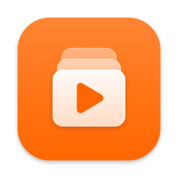
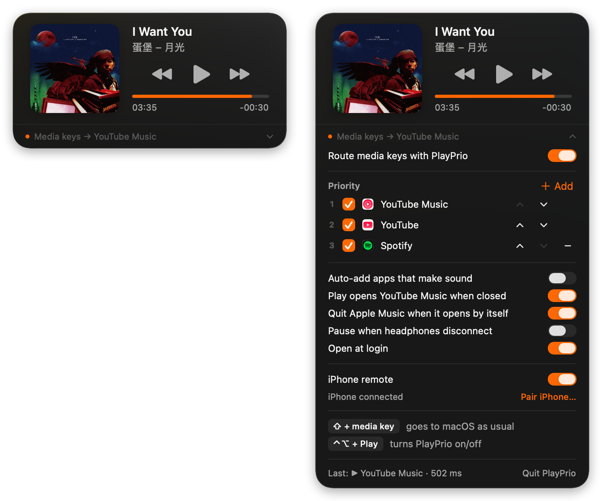
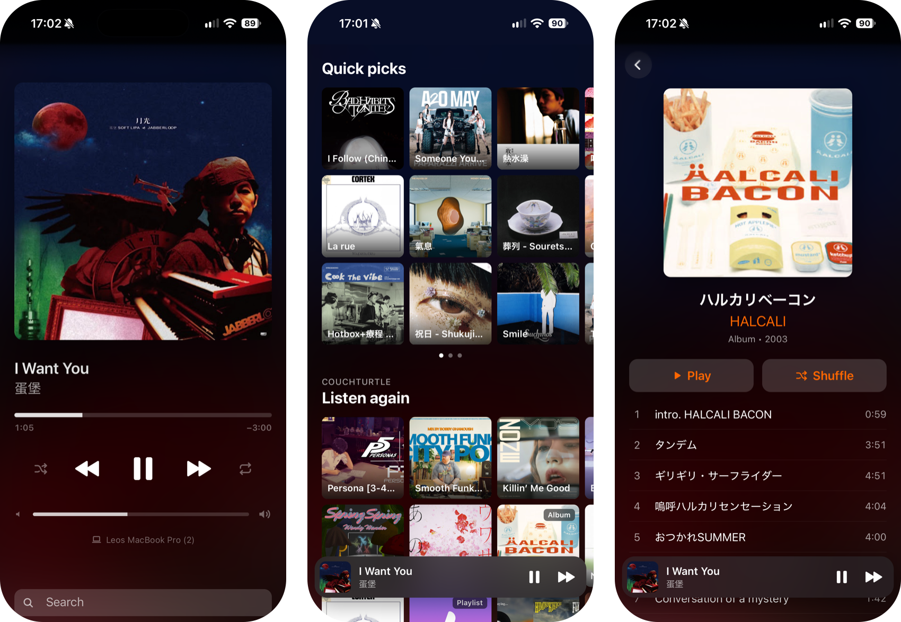

<p align="center"></p>

<h1 align="center">PlayPrio</h1>

<p align="center">
The Mac's media keys go to the music you're actually listening to, not to Apple Music.<br>
And your iPhone becomes the remote: in StandBy, on the Lock Screen, without an app.
</p>

## On the Mac

<p align="center"></p>

PlayPrio is a small menu-bar app for macOS. Play/Pause, Next and Previous go down a priority
list you set (YouTube Music in Chrome first, by default), and whatever macOS considers "Now
Playing" (QuickTime, Apple Music, a video you paused an hour ago) stops getting them.

Its panel looks like macOS's own Now Playing: the music the keys go to, large, and everything
else making sound below it, each with a pause button. The line at the bottom says where the
keys go right now; click it and the settings open:

- **Priority**: the sources in order, each on or off. **Add** puts more apps on the list.
- **Options**: add apps to the list as they make sound, open YouTube Music on Play, quit Apple
  Music when macOS opens it by itself, pause when headphones disconnect, open at login.
- **iPhone remote**: on and off, and the code to pair your iPhone.

## On the iPhone

<p align="center"></p>

Switch on the iPhone remote and PlayPrio serves a web page on your network. Open it once in
Safari and the iPhone shows what the Mac plays in its own Now Playing views: StandBy, the Lock
Screen, Control Center. Their buttons control the Mac, whatever plays there. There's no app to
install and no server anywhere; the page talks to your Mac directly.

The page itself is a small YouTube Music: your home shelves and playlists, search, albums and
artists, in YouTube Music's language. Tap something and it plays on the Mac. It also has the
Mac's volume, and seeking, shuffle and repeat for YouTube Music.

## Contents

- [Install](#install)
- [Setting up the iPhone remote](#setting-up-the-iphone-remote)
- [What the keys do](#what-the-keys-do)
- [How the iPhone remote works](#how-the-iphone-remote-works)
- [Limits](#limits)
- [Development](#development)
- [License](#license)
- [Disclaimer](#disclaimer)

## Install

Download **PlayPrio.zip** from the [latest release](../../releases/latest), unzip it and move
PlayPrio to Applications. It runs on macOS 14 or later, on Apple silicon and Intel.

PlayPrio isn't notarized by Apple (that needs a paid developer account), so macOS won't open it
the first time. Go to **System Settings → Privacy & Security**, scroll down and click **Open
Anyway** next to PlayPrio. Or, in Terminal:

```bash
xattr -dr com.apple.quarantine /Applications/PlayPrio.app
```

Then:

1. **System Settings → Privacy & Security → Accessibility**: allow PlayPrio. That's what lets
   it catch the media keys. After an update, if the keys stop working, remove PlayPrio there
   with "−" and add it again.
2. **Chrome → View → Developer → Allow JavaScript from Apple Events**, for YouTube Music and
   YouTube. Without it, PlayPrio can't see or control what plays in Chrome.
3. On the first key press, macOS asks whether PlayPrio may control Chrome: **Allow**.

To hide macOS's own Now Playing icon (PlayPrio's looks the same): System Settings → Menu Bar
(or Control Center) → Now Playing. ⌘-drag PlayPrio's icon to where you want it.

### Building it yourself

You need the Command Line Tools (`xcode-select --install`); Xcode itself isn't needed.

```bash
scripts/create-signing-identity.sh
```

```bash
./build.sh install
```

The first one is optional and needed only once. It creates a local signing certificate, so
macOS keeps the Accessibility permission across rebuilds; it asks for your login password
once. The second builds PlayPrio, copies it to `~/Applications` and starts it.
`./build.sh release` builds it for Apple silicon and Intel and zips it into
`build/PlayPrio.zip`, the file a release carries.

## Setting up the iPhone remote

1. In PlayPrio's panel, open the settings (the line at the bottom), switch on **iPhone
   remote** and click **Pair iPhone…**.
2. Scan the code with the iPhone's camera and open the page in Safari (not in a private tab).
3. Tap **Start**, then lock the iPhone or put it on a charger sideways (StandBy). Leave the
   tab open; you can switch to other apps.

That's all on a normal home network. A few things make it nicer:

- **On the Home Screen.** On the page you opened from the QR code, tap Share in Safari (on
  iOS 26 under **⋯**), then **Add to Home Screen** and leave **Open as Web App** on. It opens
  full screen with PlayPrio's icon; tap Start as usual. Add it from that page: the web app
  keeps its own copy of the key, and it comes from the address the QR code opened.
- **AirPods.** The page plays silence while the Mac plays, which is what puts it in iOS's Now
  Playing. AirPods may take that as a reason to switch to the iPhone. To stop that:
  Settings → Bluetooth → ⓘ next to your AirPods → Connect to This iPhone → **When Last
  Connected to This iPhone**.
- **Opens by itself on the charger.** Shortcuts → Automation → New → **Charger**, "Is
  Connected". Add **Get Network Details** (Wi-Fi, Network Name), then **If** it's your network,
  **Open URLs** with the page's address (it's next to the QR code; the page remembers the key).
  Set it to run immediately. You still tap Start: iOS lets a page play sound only after a tap.
- **A fixed address.** The QR code holds the Mac's IP address. Give the Mac a fixed one in your
  router (a DHCP reservation), or you'll have to pair again when it changes.
- **Separate networks** (a guest Wi-Fi, an office where phones and computers are kept apart):
  the iPhone has to be able to reach the Mac. Allow exactly that in the router's firewall:
  your iPhone → your Mac, TCP port 47269. Don't forward the port; that would open the Mac to
  the internet.

## What the keys do

**Play/Pause**

1. If something on the list plays, pause it. If other sound plays that PlayPrio can pause (an
   app, a browser tab), pause that instead of playing over it. Sound PlayPrio can't control
   itself (Quick Look, Safari, Firefox) goes to macOS, which pauses whatever played last.
   Apps that just keep their audio open (games, OBS, music software) and call apps are left
   alone.
2. Otherwise resume what PlayPrio paused last, or else the first paused source on the list.
3. If nothing is open: open YouTube Music (the Chrome app), if that option is on.

**Next / Previous** go to the source that's playing, else the first one open.

**Shortcuts:** ⇧ + media key goes to macOS as usual. ⌃⌥ + Play turns PlayPrio on or off.

**Sources**

- Built in: YouTube Music and YouTube in Chrome.
- Audio and video tabs in Chrome, Brave, Edge and Vivaldi (each needs "Allow JavaScript from
  Apple Events"; without it, keys for that browser go to macOS).
- Through AppleScript: Spotify, Apple Music, Apple TV, VLC, QuickTime Player.
- Any other app through its Play/Pause/Next menu items (experimental).
- Video players and menu-item apps are *pause only*: the key pauses them, but Play resumes
  them only if PlayPrio paused them. That way QuickTime doesn't jump ahead of YouTube Music.

**Options** (off unless noted)

- **Auto-add apps that make sound.** Controllable apps join the end of the list as they play.
- **Play opens YouTube Music when closed** (on).
- **Quit Apple Music when it opens by itself.** With no Now Playing app around, macOS starts
  Apple Music on Play (from AirPods, Control Center, or a key passed on to macOS). PlayPrio
  quits that Music right away. Music you open yourself (Dock, Spotlight, Finder) stays open.
  PlayPrio tells them apart by who launched it.
- **Pause when headphones disconnect.** When the sound moves from headphones (Bluetooth, USB,
  the jack) to the speakers or anything else, PlayPrio pauses what it controls, so the music
  doesn't carry on out loud.

## How the iPhone remote works

PlayPrio runs a small web server on port 47269. The page plays silence while the Mac plays
and hands title, artist, cover and position to iOS through the browser's Media Session API;
iOS's buttons come back to the Mac and work like the media keys. The page hears about a new
song right away (a long poll).

The QR code carries a random key after the `#`, a part of the address browsers never send.
Every request is signed with it (HMAC-SHA256) and accepted once, within a minute. Others on
the network can't control anything. The connection isn't encrypted, so someone watching the
network could see which song is playing. **New Key** in the settings locks out every iPhone
paired so far.

## Limits

- The buttons on AirPods and other headphones don't go through the keyboard; PlayPrio doesn't
  reroute them.
- "Pause when headphones disconnect" watches the default output. With an app that routes all
  sound through a virtual device (Background Music, Loopback), it can't see what's behind it.
- "Quit Apple Music when it opens by itself": Music started by a script (`open` in Terminal,
  AppleScript) has no launching app either, so it's quit too.
- When YouTube Music changes its page, the selectors in `Targets.swift` and
  `CompanionLibrary.swift` may need an update.
- Liquid Glass and the macOS 26 switches need the macOS 26 SDK (Command Line Tools 26); with an
  older SDK, PlayPrio builds with the older look.
- "Allow JavaScript from Apple Events" applies to the whole browser, for every app you allow to
  control it.

## Development

Testing without pressing keys:

```bash
build/PlayPrio.app/Contents/MacOS/PlayPrio --probe
```

| Command | What it does |
|---|---|
| `--probe` | the state of every source, and other apps making sound |
| `--do playPause` (or `next`, `previous`) | route one key press like the app would |
| `--pass-key playPause` | send a key to macOS, past PlayPrio |
| `--headphones-gone` | pause like when headphones disconnect |
| `--snapshot panel.png [--expanded]` | render the panel with live data (light only) |
| `--panel-test [--expanded]` | open the real panel briefly and print where it went |

The iPhone API, signed like the page:

```bash
scripts/companion-request.sh GET /api/state
```

```bash
scripts/companion-request.sh POST /api/command '{"action":"playPause"}'
```

Logs: `/usr/bin/log stream --predicate 'subsystem == "local.PlayPrio"'`.

| File | What's in it |
|---|---|
| `main.swift` | starts the app, or one of the test commands |
| `MediaKeyTap.swift` | catches the media keys (a CGEventTap on its own thread) |
| `Router.swift` | the priority logic |
| `Targets.swift` | sources: Chrome pages and browser tabs through JavaScript, known players through AppleScript, else menus |
| `OtherAudio.swift` | sound outside the list (apps, browser tabs, Quick Look) and how to pause it |
| `AudioProcesses.swift`, `AudioProperty.swift` | which processes are making sound (Core Audio) |
| `HeadphoneWatcher.swift` | notices when the sound leaves the headphones |
| `SystemVolume.swift` | the Mac's output volume |
| `MenuControl.swift`, `Accessibility.swift` | Play/Pause menu items and window titles through Accessibility |
| `AppleScript.swift` | AppleScript and Chromium scripting (with a 3 s timeout) |
| `Settings.swift` | the stored settings |
| `Store.swift` | the panel's state; all scripting runs on one queue |
| `PanelView.swift` | the panel (SwiftUI) |
| `PanelController.swift`, `StatusPanel.swift` | the window below the menu bar and its animation |
| `AppDelegate.swift` | menu-bar icon, Accessibility permission, the Apple Music guard |
| `Companion.swift` | iPhone remote: the state for the iPhone, commands, signatures, covers |
| `CompanionServer.swift` | the small HTTP server (Network.framework) |
| `CompanionPage.swift` | the iPhone page (HTML, CSS, JavaScript) and the silence it plays |
| `CompanionLibrary.swift` | YouTube Music for the iPhone: shelves, search, albums, artists, playing |
| `CompanionSettings.swift` | the remote's switch and QR code in the panel |
| `DevCommands.swift` | the test commands above |
| `build.sh` | builds with just the Command Line Tools; `release` zips it for Apple silicon and Intel |
| `scripts/make-icon.swift` | draws the app icon and the iPhone page's icon |

## License

MIT, see [LICENSE](LICENSE).

## Disclaimer

- **Made with AI.** PlayPrio was coded with Claude, Anthropic's AI model, and tested by hand on
  a Mac and an iPhone.
- **Unofficial.** It isn't affiliated with or endorsed by Apple, Google or YouTube. Their names
  are their trademarks, used here only to say what PlayPrio works with.
- **YouTube Music's internal API.** The iPhone remote reads YouTube Music through the API its
  own web page uses, from your signed-in tab, as you. It isn't a public API: it can change or
  stop working at any time, and whether you use it this way is between you and YouTube's terms.
- **Your data.** There's no server and no analytics. PlayPrio talks to the apps and browser tabs
  on your Mac, to your iPhone if you pair one, and loads the covers the players point to. Its
  settings and the pairing key stay on your Mac.
- **Permissions.** It needs Accessibility to catch the media keys, and permission to control
  your browser. Like any app with that access, it can do a lot; the code is here to read.
- **No warranty.** It's provided as is, as the license says.
